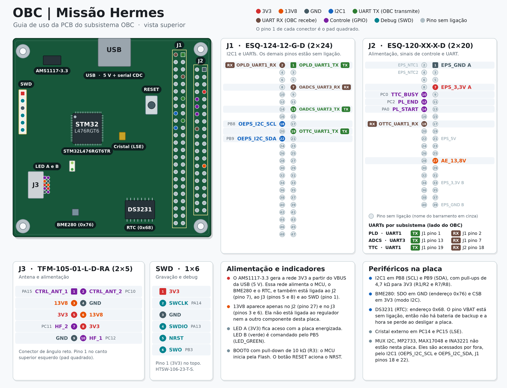
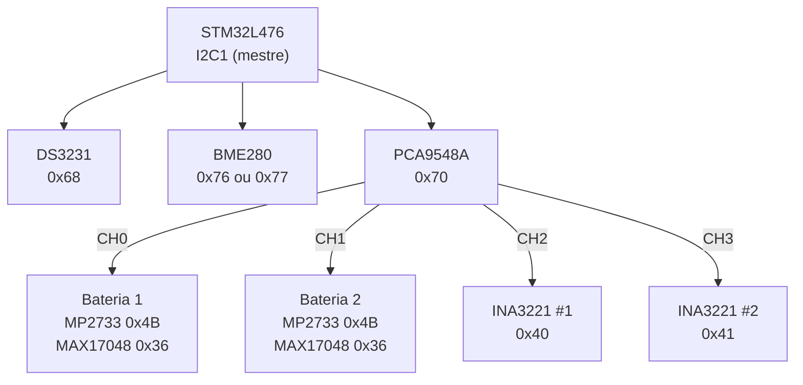

# OBC | Missão Hermes

Documentação do subsistema **OBC (On-Board Computer)** da Missão Hermes. A placa é baseada em um **STM32L476RGT6TR** e centraliza a leitura de sensores ambientais, do relógio de tempo real e de todo o subsistema de energia (carregadores, medidores de bateria e monitores de tensão/corrente). Os dados são enviados em texto por **USB CDC** e as três UARTs ficam disponíveis para comunicação com os outros subsistemas.

Este README descreve o hardware e o funcionamento do firmware (`main.c`).

## Visão geral

- Lê, a cada ciclo de cerca de 1 s, o RTC, o sensor BME280, dois carregadores de bateria, dois medidores de carga e dois monitores de potência.
- Usa um **MUX I2C (PCA9548A, 0x70)** para isolar dispositivos que compartilham o mesmo endereço (dois MP2733 e dois MAX17048).
- Imprime tudo no terminal USB (porta COM virtual) e preenche uma estrutura de telemetria (`telemetryFull t1`).
- Recebe dados nas três UARTs (USART1, USART2 e USART3) por interrupção e repassa o conteúdo ao terminal USB.
- Reaplica periodicamente a configuração de corrente dos carregadores MP2733.

## Hardware

### Guia de uso da PCB

A imagem abaixo resume a placa em vista superior: posição dos conectores (J1, J2, J3 e SWD), pinagem com os nomes dos sinais do barramento, TX e RX de cada UART por subsistema, alimentação e periféricos de bordo.



Pontos para quem for ligar a placa:

- O pino 1 de cada conector é o pad quadrado.
- TX é o sinal que o OBC transmite e RX é o sinal que o OBC recebe (nomes vistos do lado do OBC). O par da UART do TTC fica em conectores diferentes: `OTTC_UART1_TX` no J1 (pino 19) e `OTTC_UART1_RX` no J2 (pino 18).
- A rede 3V3 é gerada na placa pelo AMS1117-3.3 a partir do VBUS da USB. A rede 13V8 só aparece nos conectores J2 e J3.

### Microcontrolador e clock

| Item | Configuração |
|---|---|
| MCU | STM32L476RGT6TR (Cortex-M4) |
| SYSCLK | HSI (16 MHz), HCLK, PCLK1 e PCLK2 sem divisão |
| MSI | 48 MHz, com LSE ligado (modo MSI PLL, calibração automática pelo cristal de 32,768 kHz) |
| Regulador | Voltage Scale 1 |
| USB | `VddUSB` habilitado no boot (`HAL_PWREx_EnableVddUSB`) |
| I2C1 | 7 bits, Standard mode (cerca de 100 kHz), `TIMINGR = 0x00503D58`, filtro analógico ligado |
| USART1, 2 e 3 | 115200 bps, 8N1, sem controle de fluxo |

### Componentes

| Componente | Função | Endereço I2C | Onde está |
|---|---|---|---|
| PCA9548A | MUX I2C de 8 canais (A0, A1 e A2 em GND) | 0x70 | I2C1 direto |
| DS3231 | RTC com sensor de temperatura | 0x68 | I2C1 direto |
| BME280 | Temperatura, pressão e umidade | 0x76 ou 0x77 | I2C1 direto |
| MP2733 (x2) | Carregador de bateria | 0x4B | MUX CH0 e CH1 |
| MAX17048 (x2) | Medidor de carga (fuel gauge) | 0x36 | MUX CH0 e CH1 |
| INA3221 (x2) | Monitor de tensão e corrente de 3 canais | 0x40 e 0x41 | MUX CH2 e CH3 |

### Topologia do barramento I2C



### Por que usar o MUX

Os dois MP2733 respondem em 0x4B e os dois MAX17048 em 0x36, então não podem estar no mesmo barramento ao mesmo tempo. Cada bateria fica em um canal do MUX, e o firmware habilita **um canal por vez**.

O PCA9548A tem um único registrador de controle de 1 byte, em que o bit `n` liga o canal `n`. Por isso o firmware escreve `1 << canal` para selecionar e `0x00` para isolar todos os canais (`MUX_DisableAll`). O MUX é isolado antes de qualquer leitura nos dispositivos diretos e ao fim de cada ciclo. Os canais 4 a 7 não são usados.

## Interfaces

### USB CDC (terminal)

Toda a saída de diagnóstico sai pela USB CDC (porta COM virtual) através da função `USB_Print()`.

- Se a USB ficar ocupada por mais de 20 ms, a mensagem é **descartada** para não travar o loop.
- Há uma pausa de 5 ms após cada mensagem.
- Depois do reset, aguarde cerca de 2 s para a porta enumerar. O firmware espera esse tempo de propósito antes de imprimir.

### UARTs

As três UARTs usam `HAL_UARTEx_ReceiveToIdle_IT` com buffer de 64 bytes (até 63 bytes úteis por quadro). O funcionamento é o mesmo nas três:

1. A recepção termina quando a linha fica ociosa (evento IDLE).
2. `HAL_UARTEx_RxEventCallback` copia o quadro para `msg_uN`, coloca o terminador `\0`, levanta a flag `new_data_uN` e rearma a recepção.
3. No loop principal, a flag é tratada: o conteúdo é impresso no terminal USB como `UARTn RX: ...` e o LED correspondente acende naquele ciclo.
4. Em caso de erro de overrun, framing ou ruído, `HAL_UART_ErrorCallback` limpa as flags e rearma a recepção.

Se chegar um novo quadro antes de o loop processar o anterior, o anterior é sobrescrito. A USART2 também recebe o redirecionamento do `printf` (`__io_putchar`), embora o `main.c` use apenas `snprintf` + `USB_Print`.

### GPIOs

| Pino | Uso |
|---|---|
| PB5 | LED verde de boot (3 pulsos ao ligar) |
| PC10 | Alterna a cada leitura bem-sucedida do BME280 |
| PC0 | Indicador de recepção na USART1 |
| PA0 | Indicador de recepção na USART2 |
| PC2 | Indicador de recepção na USART3 |
| PC11, PC12, PA15 | Configurados como saída em nível baixo, sem uso nesta versão |

## Funcionamento do firmware

### Sequência de boot

1. Inicializa HAL, PWR, clocks, GPIO, USB, I2C1 e as três USARTs.
2. Pisca o LED verde (PB5) 3 vezes (150 ms ligado e 150 ms desligado) e espera mais 1100 ms, completando 2 s para a enumeração da USB CDC.
3. Imprime o banner e um relatório dos pinos PB6 a PB9 (modo, função alternativa, nível lógico) mais o flag `BUSY` do I2C1. Serve para diagnosticar problemas de barramento.
4. Detecta o MUX em 0x70 e isola todos os canais.
5. Faz o scan do barramento principal. Esperado: `0x68` (DS3231), `0x70` (MUX) e `0x76` ou `0x77` (BME280).
6. Inicializa o BME280 e o DS3231.
7. Inicializa os dispositivos atrás do MUX, canal por canal:
   - CH0: MP2733 e MAX17048 da bateria 1
   - CH1: MP2733 e MAX17048 da bateria 2
   - CH2: INA3221 0x40
   - CH3: INA3221 0x41
8. Isola o MUX, limpa as flags de erro das UARTs e inicia a recepção por interrupção.
9. Carrega os valores padrão da telemetria (`Telemetry_InitDefaults`).

Cada dispositivo que responde recebe uma flag `*_ativo`. Só os dispositivos ativos são lidos no loop.

### Loop principal

A cada ciclo (cerca de 1 s, pelo `HAL_Delay(1000)` somado ao tempo das leituras):

1. Isola o MUX e lê o **DS3231** (data, hora e temperatura).
2. Lê o **BME280** em modo forçado.
3. Lê os dispositivos do MUX, um canal por vez: bateria 1 (CH0), bateria 2 (CH1), INA 0x40 (CH2) e INA 0x41 (CH3). Ao final, isola o MUX.
4. Trata as flags das três UARTs.
5. Imprime o separador `----------------------------`.

Dispositivos diretos (RTC, BME280) e o próprio MUX que não responderam são **redetectados automaticamente** a cada ciclo.

### Detalhes por dispositivo

#### DS3231 (RTC)

Lê data, hora e temperatura (em centésimos de °C) e preenche `hora`, `minuto`, `segundo`, `dia`, `mes` e `ano` (2 dígitos) da telemetria. Se o RTC não responder, o segundo da telemetria é incrementado por software (0 a 59) enquanto o firmware tenta reconectar.

O acerto da hora é controlado por `DS_TIME_SOURCE`:

| Valor | Comportamento |
|---|---|
| `0` | Não acerta a hora. Só acerta com a data/hora da compilação se o flag OSF (oscilador parado) estiver em 1 |
| `1` | Acerta **sempre** no boot com a data/hora da compilação (valor atual) |
| `2` | Acerta **sempre** no boot com os valores fixos `DS_FIXED_*` |

> **Atenção:** com `DS_TIME_SOURCE = 1` ou `2`, toda vez que a placa reiniciar o RTC volta para a hora da compilação (ou a fixa). Para uso real, prefira `0`.

#### BME280

Tenta o endereço 0x76 e depois o 0x77. O chip é identificado pelo ID: `0x60` é BME280 e `0x58` é BMP280 (que não mede umidade). A leitura usa modo forçado e fornece temperatura (centésimos de °C), pressão (Pa) e umidade (centésimos de %UR). A temperatura é copiada para `temperatura_externa` da telemetria.

Em caso de erro, o contador `dbg_error_count` aumenta e o sensor é marcado como não encontrado, para ser detectado de novo no próximo ciclo. As variáveis `dbg_temp_c`, `dbg_press_hpa`, `dbg_hum_pct`, `dbg_read_count` e `dbg_error_count` podem ser acompanhadas no Live Watch do debugger.

#### MP2733 (carregadores, via MUX)

Na inicialização: `MP2733_Init`, espera de 50 ms, verificação de presença em 0x4B, leitura de status, `MP2733_WriteConfig` e ajuste das correntes por leitura, modificação e escrita (`MP2733_SetCustomCurrent`):

| Parâmetro | Registrador | Valor | Resultado |
|---|---|---|---|
| Limite de corrente de entrada (IINLIM) | REG00h | `0x1C` | 100 mA + 28 x 50 mA = **1500 mA** |
| Corrente de carga/saída (ICC) | REG05h | `0x19` | 25 x 40 mA = **1000 mA** |

No loop, essas duas configurações são **reaplicadas a cada ciclo**, para evitar que o watchdog do MP2733 volte os registradores ao padrão. Também são lidos REG00h e REG05h e os valores decodificados são impressos. O status e a falha de cada carregador vão para `status_carregador_N` e `falha_carregador_N` da telemetria.

#### MAX17048 (medidores de carga, via MUX)

Na inicialização verifica a presença em 0x36 (se não responder, a mensagem sugere verificar a bateria), inicializa e lê o registrador VERSION (0x08). No loop lê o **SOC** (%) e a **tensão** da bateria, e grava em `carga_bateria_N` (%) e `tensao_bateria_N` (mV).

#### INA3221 (monitores de potência, via MUX)

Cada INA3221 é inicializado com o parâmetro de shunt `200`, recebe um reset de configuração, espera 10 ms e aplica a configuração padrão do driver.

| Dispositivo | Canal do MUX | Leituras |
|---|---|---|
| INA3221 #1 (0x40) | CH2 | Tensão de barramento dos 3 canais (V1, V2, V3) |
| INA3221 #2 (0x41) | CH3 | Corrente de shunt dos canais 1 e 2 (I1, I2) e tensão de barramento do canal 3 (V3) |

## Telemetria

A estrutura `telemetryFull t1` reúne os dados do sistema. Nesta versão, os campos abaixo são preenchidos com leituras reais:

| Campo | Origem |
|---|---|
| `hora`, `minuto`, `segundo`, `dia`, `mes`, `ano` | DS3231 |
| `temperatura_externa` | BME280 (°C) |
| `tensao_13v8` | INA3221 #1, V1 |
| `tensao_5v` | INA3221 #1, V2 |
| `corrente_13v8` | INA3221 #2, I1 (dividido por 1000) |
| `corrente_5v` | INA3221 #2, I2 (dividido por 1000) |
| `status_carregador_1`, `falha_carregador_1` | MP2733 da bateria 1 |
| `status_carregador_2`, `falha_carregador_2` | MP2733 da bateria 2 |
| `tensao_bateria_1`, `carga_bateria_1` | MAX17048 da bateria 1 (mV e %) |
| `tensao_bateria_2`, `carga_bateria_2` | MAX17048 da bateria 2 (mV e %) |

Os demais campos (`temperatura_bateria`, `deploy_antena`, `tensao_painel_solar_1` a `4`, `adc_*` e `taxa_carga_descarga_bateria_*`) mantêm os **valores fixos de teste** definidos em `Telemetry_InitDefaults()`. As tensões V3 dos dois INA3221 são apenas impressas e ainda não entram na telemetria.

O empacotamento (`readyData`, `parseData` e `printTelemetry`, com buffer de 51 bytes) está comentado no `main.c` e ainda não é executado.

## Saída serial

Exemplo do formato impresso no terminal (valores ilustrativos):

```text
=== Sistema OBC Missao Hermes (I2C1 + MUX 0x70) ===
MUX I2C encontrado em 0x70
Scan I2C1 principal: 0x68 0x70 0x76
Sensor: BME280 (0x60)
DS3231 encontrado
Hora do DS3231 acertada
MP1 (CH0) -> Configurado OK (Iout = 1.0 A)
MAX1 (CH0) -> Configurado OK (Ver: 0x0012)
INA1 (CH2 - 0x40) -> Configurado OK
INA2 (CH3 - 0x41) -> Configurado OK
```

A cada ciclo:

```text
RTC: 2026-11-22 (dom) 14:30:05 | Temp RTC: 27.25 C
BME280: T=24.80 C | P=1013.25 hPa | UR=52.40 %
[MP1 - CH0] IinLim: 1500 mA (0x1C) | Ichg: 1000 mA (0x19)
[MAX1 - CH0] SOC: 85.20% | Vbat: 4.012 V
[MP2 - CH1] IinLim: 1500 mA (0x1C) | Ichg: 1000 mA (0x19)
[MAX2 - CH1] SOC: 84.70% | Vbat: 4.005 V
INA1 (0x40) -> V1: 12.534 V | V2: 4.987 V | V3: 5.054 V
INA2 (0x41) -> I1: 132.00 mA | I2: 87.40 mA | V3: 5.054 V
----------------------------
```

As mensagens usam aritmética inteira (sem `%f`), então não é preciso habilitar `printf` com float no newlib-nano.

Mensagens de falha típicas: `... -> Nao respondeu`, `... -> Erro na comunicacao`, `... -> Erro leitura I2C`, `MUX I2C (0x70) nao respondeu` e `Erro na leitura do BME280`.

## Configuração (defines em `main.c`)

| Define | Descrição |
|---|---|
| `DS_TIME_SOURCE` | Modo de acerto da hora do DS3231 (0, 1 ou 2) |
| `DS_FIXED_YEAR`, `_MONTH`, `_DAY`, `_HOUR`, `_MIN`, `_SEC` | Data e hora usadas quando `DS_TIME_SOURCE = 2` |
| `MUX_ADDR`, `INA_ADDR`, `INA_ADDR2` | Endereços I2C (7 bits) do MUX e dos dois INA3221 |
| `CH_BAT1`, `CH_BAT2`, `CH_INA1`, `CH_INA2` | Canais do MUX (0, 1, 2 e 3) |
| `MP2733_IINLIM_1_5A` | Valor do REG00h para limite de entrada de 1,5 A |
| `MP2733_ICHG_1_0A` | Valor do REG05h para corrente de carga de 1,0 A |
| `RX_BUF_SIZE` | Tamanho do buffer de recepção das UARTs (64) |

## Bibliotecas usadas

Drivers próprios incluídos pelo `main.c`: `ina3221.h`, `max17048.h`, `mp2733.h`, `ds3231.h`, `bme280.h` e `dataReadying.h` (telemetria). O restante vem do HAL STM32L4 (I2C, UART, PCD) e da pilha USB CDC (`usbd_cdc_if.h`).

## Compilação e gravação

- Toolchain: `arm-none-eabi-gcc`, Cortex-M4 com hard-float, linker script `STM32L476RGTx_FLASH.ld`.
- Compilar: `make`
- Gravar com ST-Link: `st-flash write build/firmware_hermes.bin 0x8000000` (ajuste o caminho do `.bin` conforme o seu Makefile).
- Abrir a porta COM virtual em qualquer terminal serial e aguardar cerca de 2 s após o reset.

## Limitações conhecidas e pendências

- Os dispositivos atrás do MUX (MP2733, MAX17048, INA3221) só são inicializados **no boot**. Se algum não responder nessa hora, ele fica inativo até o próximo reset. Já o RTC, o BME280 e o próprio MUX são redetectados em tempo de execução.
- Empacotamento e envio da telemetria ainda desativados.
- Vários campos da telemetria ainda usam valores fixos de teste.
- As UARTs apenas repassam o que recebem ao terminal USB, sem protocolo definido.
- O mapeamento das tensões e correntes do INA3221 para `13v8` e `5v` precisa ser conferido com os barramentos físicos da placa. O código assume que `INA3221_get_shunt_current` retorna mA.
- `DS_TIME_SOURCE` está em `1`, o que sobrescreve a hora do RTC a cada boot.
